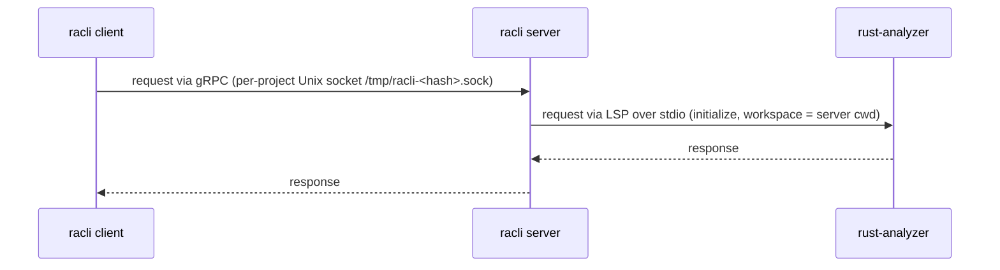
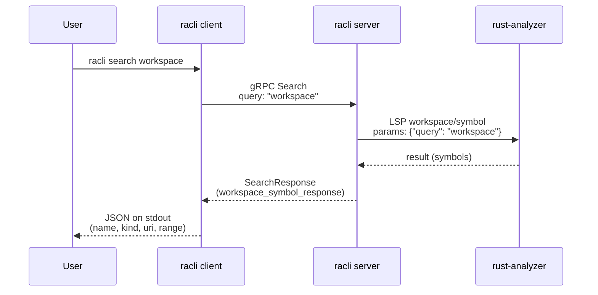
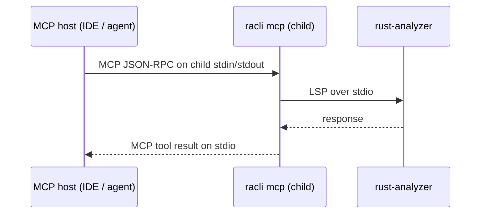
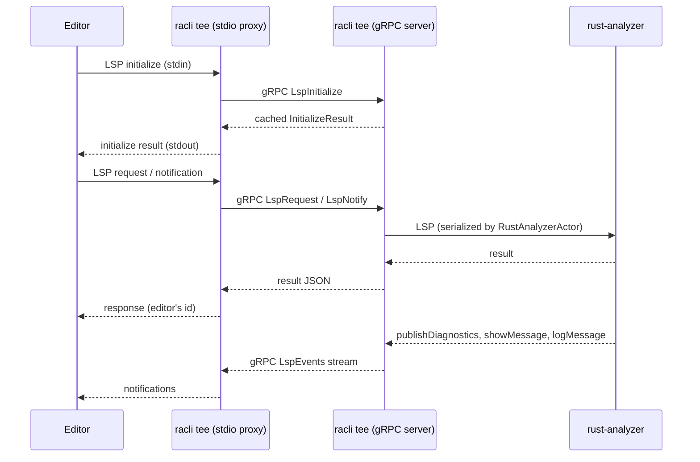
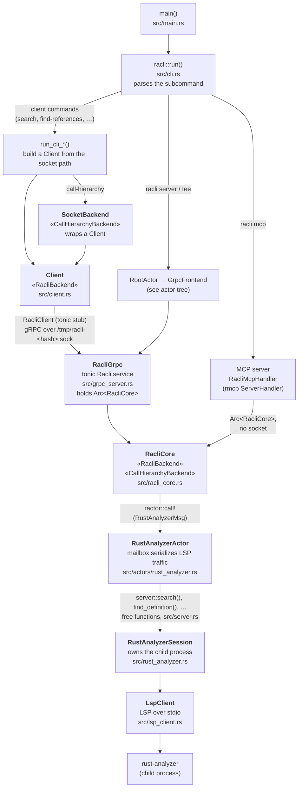
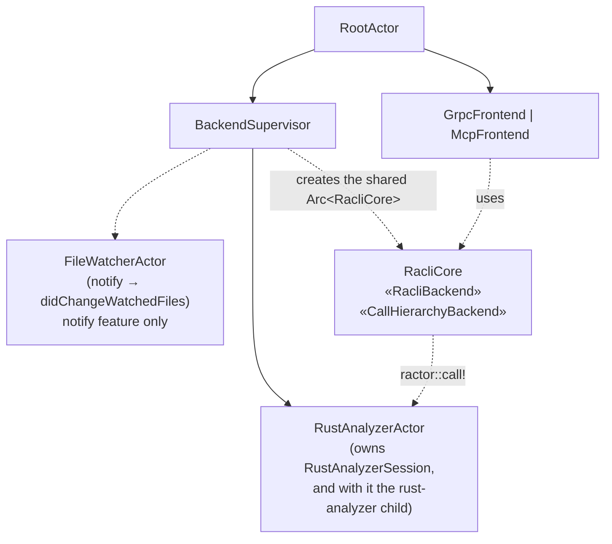

# High-level architecture

## racli server

`racli` splits work between a **client** (CLI invocations that talk to the socket), a **server** (gRPC over a Unix socket plus an LSP child), and **rust-analyzer** (the actual language server).

### Example: `racli search`

For `racli search <query>` (here `racli search workspace`), the client sends gRPC **`Search`**. The server calls rust-analyzer with the LSP JSON-RPC method **`workspace/symbol`** (implemented in code as `RustAnalyzerSession::workspace_symbol`).

The client only speaks gRPC to `racli server`, and finds the server's socket by checking its working directory and then each parent directory for a running server. The server owns the `rust-analyzer` process and the LSP session for the directory where the server was started.

## racli mcp

MCP hosts (for example **Cursor**, **Claude Desktop**, or any client that speaks the [Model Context Protocol](https://modelcontextprotocol.io)) register `racli mcp` as an MCP server **command**. When a session needs tools, the host **spawns** that command as a **child process** and drives MCP over the child’s **stdio**: framed JSON-RPC on **stdin** / **stdout**, with **stderr** available for logs.

The MCP child process **starts its own rust-analyzer session** (same LSP `initialize` / `initialized` flow and workspace file watching as `racli server`) and serves tools **in-process**. It does **not** connect to `racli server` over the Unix socket. Each tool is a **client command** (`search`, `find_definition`, `find_references`, `find_implementations`, `call_hierarchy`, `document_symbols`, plus `get_version`): the command's own code runs against the in-process `RacliCore` instead of a gRPC `Client`, and the tool returns what the command prints. See [ADR 006](adrs/006-mcp-tools-mirror-the-cli.md).

Configure the MCP host so the **`racli mcp` working directory** is the intended Rust workspace root (the directory you would `cd` into before running `cargo build`). Relative paths in tool results and parameters are relative to it. **`racli server`** remains the path for CLI clients (`racli search`, `racli find-definition`, `racli version`): those commands still use gRPC on the Unix socket.

## racli tee

`racli tee` runs the `racli server` actor tree in-process and also serves LSP on stdio for an editor. The stdio proxy is an ordinary gRPC client of the socket, so editor traffic goes through the same `RustAnalyzerActor` mailbox as every other client.

The editor's `shutdown` is acknowledged locally, and `exit` (or stdin EOF) shuts the whole tree down.

## From `main()` to rust-analyzer

The types a request passes through, from the CLI's `main()` to the rust-analyzer child. Structs carry the in-crate traits they implement in `«guillemets»`:

- **`RacliBackend`** (`src/racli_backend.rs`) is the set of operations the client commands use: `search`, `find_definition`, `find_references`, `find_implementations`, `document_symbols` and `hover`. Each command's `run_*` function takes a `&dyn RacliBackend`, so the same code runs over the socket (CLI) or in-process (MCP). See [ADR 006](adrs/006-mcp-tools-mirror-the-cli.md).
- **`CallHierarchyBackend`** (`src/call_hierarchy.rs`) is the smaller set of operations the call-hierarchy walk needs (prepare, incoming and outgoing calls).

- **`Client` and `RacliCore` implement the same trait for different reasons.** `Client` forwards each operation over the socket to a server that does the work. `RacliCore` does the work itself: it calls the actor that owns rust-analyzer. `RacliGrpc` is a thin adapter: it receives each gRPC request and calls the `RacliCore` it holds.
- **`RacliCore` is shared.** The socket server (`racli server`, `racli tee`) and `racli mcp` each build one and use it from their front end.
- **`SocketBackend`** exists because `RacliBackend` doesn't include the three call-hierarchy operations. It wraps a `Client` and unwraps its gRPC replies into the LSP types `CallHierarchyBackend` returns, while `RacliCore` implements `CallHierarchyBackend` directly for MCP.
- **`RustAnalyzerSession` is the only type that owns the child process.** `RacliCore` holds a handle to the actor that owns the `RustAnalyzerSession`, not the session itself.

## Internal actor tree

Inside `racli server` and `racli mcp`, long-lived work is supervised by [ractor](https://docs.rs/ractor) actors (`src/actors/`):

- **File watching:** by default rust-analyzer watches the workspace itself (`files.watcher: "server"`), and there is no `FileWatcherActor`. Built with the `notify` feature, racli starts its own watcher instead and sends rust-analyzer `workspace/didChangeWatchedFiles`. See [ADR 005](adrs/005-file-watching-by-rust-analyzer.md).
- **Startup:** rust-analyzer is spawned and LSP-initialized, then the file watcher starts (with the `notify` feature), then the front end binds the Unix socket (gRPC) or completes the MCP handshake. A failure at any step tears down what already started.
- **Requests:** gRPC/MCP handlers call `RacliCore`, which sends messages to `RustAnalyzerActor`; its mailbox serializes LSP traffic.
- **Shutdown** (SIGINT/SIGTERM, gRPC serve error, or MCP stdin EOF) runs in reverse: front end → file watcher, if any (queued events drained) → rust-analyzer (`shutdown`/`exit`, then wait for the child).
- **Failures:** a crashed backend actor is logged, not restarted; later requests fail with an `Internal` error.
